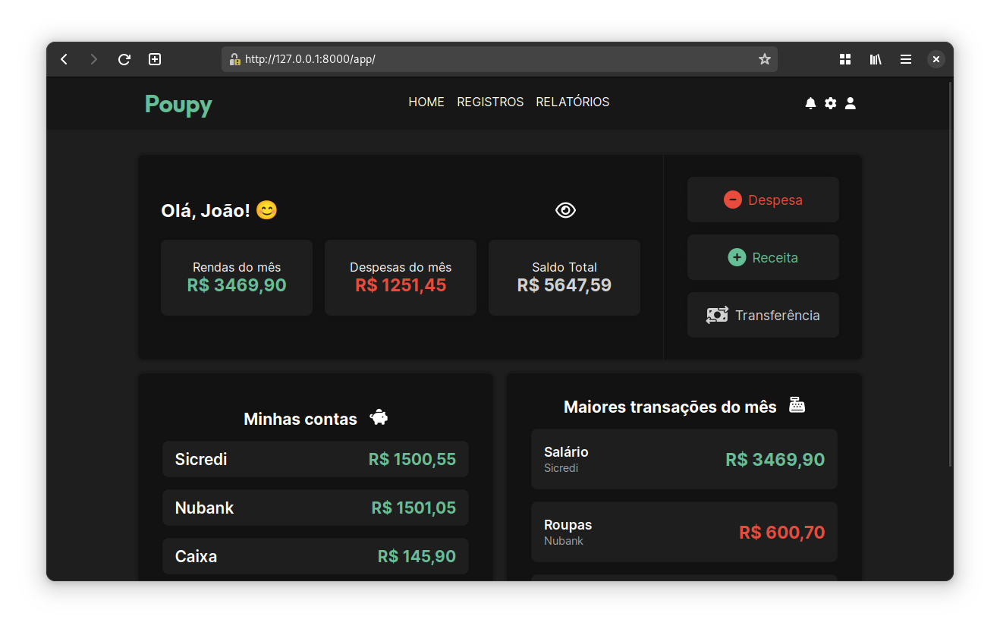

<h1 align="center">
    <br>
</h1>

<p align="center"><strong>Manage your personal budget.</strong></p>

<p align="center">
    <a href="https://github.com/henriquesebastiao/poupy/actions/workflows/ci.yml">
        
    </a>
    <a href="https://coverage-badge.samuelcolvin.workers.dev/redirect/henriquesebastiao/poupy" > 
         
    </a>
    <a href="https://github.com/henriquesebastiao/poupy/">
        
    </a>
    <a href="https://poupy.henriquesebastiao.com/">
        
    </a>
    <a href="https://github.com/henriquesebastiao/poupy/releases/">
        
    </a>
    <a href="https://github.com/henriquesebastiao/poupy/blob/main/LICENSE">
        
    </a>
</p>

<p align="center">
    
</p>

Poupy é um aplicativo web para gerenciamento de orçamento e gastos pessoais, desenvolvido com Django. Ele permite o controle financeiro completo, incluindo a gestão de contas bancárias, receitas, despesas e transferências de saldo entre contas. Com um dashboard intuitivo, o usuário pode visualizar rapidamente um resumo financeiro mensal e manter suas finanças organizadas.

> [!NOTE]
> Uma vez que o projeto tenha sido desenvolvido para fins de estudo e o mesmo foi finalizado, não tendo seu desenvolvimento continuado, estarei arquivando este repositório na data de 2026-01-24.

## Deploy 🚀

Você pode acessar o aplicativo [aqui](https://poupy.henriquesebastiao.com/app/login).

Entre na conta de demonstração clicando em `Login as User Demo`.

Você também pode visualizar o deploy do banco de dados usando **Adminer** neste [link](https://adminer.henriquesebastiao.com/?pgsql=projects_postgres&username=poupy&db=poupy&ns=public).

Use a senha `poupy123`.

> Este usuário é apenas para leitura, fique a vontade para bisbilhotar :)

## Funcionalidades

- **Adição de contas bancárias**: Adicione e gerencie várias contas bancárias.
- **Registro de receitas e despesas**: Registre suas entradas e saídas de dinheiro para melhor controle.
- **Transferência entre contas**: Movimente saldo entre contas cadastradas.
- **Dashboard completo:**
    - Saldo total de todas as contas.
    - Total de entradas e saídas mensais para um resumo rápido do fluxo financeiro.
    - Saldo por conta para acompanhar a situação de cada conta individualmente.
    - Maiores movimentações: Exibe as três maiores movimentações do mês, destacando receitas e despesas mais significativas.

Tecnologias e ferramentas usadas no projeto:

- **Python** com **Django** para o backend.
- **HTML5** e **CSS3** para o frontend.
- **PostgreSQL** para armazenamento de dados.
- **PyTest** e **Selenium** para testes unitários e funcionais.
- **Docker** para desenvolvimento em containers.
- **Ruff** para formatação de código.
- **GitHub Actions** para execução de pipelines de CI.

> [!TIP]
> Você pode ver a cobertura dos testes [aqui](https://coverage-badge.samuelcolvin.workers.dev/redirect/henriquesebastiao/poupy).

## Executando o projeto localmente

> [!NOTE]
> Os passos listados abaixo são baseados em sistemas Unix, podendo para variar para outros sistemas operacionais. No passa a passo é exemplificada a execução com SQLite com banco de dados, mas o projeto usa PostgreSQL e Docker para deploy.

> [!IMPORTANT]
> Para executar o projeto você deve ter o [Python](https://www.python.org/) e [Git](https://git-scm.com/) instalados em seu computador.

### Clonando o repositório

```shell
git clone https://github.com/henriquesebastiao/poupy.git && cd poupy
```

## Criando e ativando o ambiente virtual Python

É essencial a criação um ambiente virtual exclusivo para o projeto, visando evitar eventuais conflito com outros pacotes python instalados em seu computador.

```shell
python -m venv .venv
source .venv/bin/activate
```

### Atualizando o `pip` e instalando as dependências do projeto

```shell
pip install --upgrade pip
pip install -r requirements.txt
```

### Configurando as variáveis de ambiente

O projeto conta com um arquivo de modelo para a criação do `.env`, sendo assim, basta apenas duplicá-lo com o nome .env

```shell
cp .env.example .env
```

### Reunindo arquivos estáticos e criando banco de dados

O último passo antes de executar o aplicativo, é juntar todos os arquivos estáticos responsáveis por dar estilo ao aplicativo e aplicar as migrações no banco de dados.

```shell
python manage.py collectstatic
python manage.py migrate
```

### Executando o aplicativo ✨

Agora execute o seguinte comando para executar o aplicativo:

```shell
python manage.py runserver
```

Acesse o aplicativo em [http://localhost:8000](http://localhost:8000)
